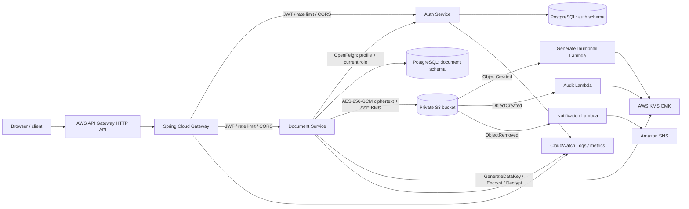

# Secure Document Management System

A Java 21 / Spring Boot 3.5 multi-service reference implementation for private document storage on AWS. The repository includes a reactive Spring Cloud Gateway, a stateless authentication service, a document service, Terraform for AWS resources, S3-triggered Lambda handlers, Docker Compose for local development, Kubernetes manifests, and a Postman collection.

> **Deployment note:** this is a production-oriented starter, not a claim that every AWS account, region, network, retention policy, and compliance requirement is preconfigured for your organization. Review the security checklist below, set real secret values, and exercise the deployment in a non-production account before release.

## Architecture



The external AWS API Gateway is the managed edge endpoint configured in Terraform. The Spring Cloud Gateway is an application service behind that edge: it validates RSA-signed JWTs, logs requests, applies Redis-backed rate limits, enforces CORS, and routes to the services. The Terraform integration is deliberately configurable so it can be attached to the networking/compute front door selected by the deployment (for example a VPC Link to an internal load balancer).

## Request sequence

```mermaid
sequenceDiagram
    autonumber
    actor Client
    participant Edge as AWS API Gateway
    participant Gateway as Spring Cloud Gateway
    participant Auth as Auth Service
    participant DB as Auth PostgreSQL
    participant Docs as Document Service
    participant KMS as AWS KMS
    participant S3 as Private S3
    participant Lambda as S3 Lambda handlers

    Client->>Edge: POST /auth/register
    Edge->>Gateway: Forward request
    Gateway->>Auth: Register user (BCrypt)
    Auth->>DB: Persist USER and hashed password
    Auth-->>Client: 201 user profile
    Client->>Edge: POST /auth/login
    Edge->>Gateway: Forward request
    Gateway->>Auth: Authenticate credentials
    Auth->>DB: Verify stored BCrypt hash
    Auth-->>Client: RS256 access JWT + opaque refresh token
    Client->>Edge: POST /documents/upload + Bearer JWT
    Edge->>Gateway: Forward request
    Gateway->>Gateway: Verify JWT, apply rate limit
    Gateway->>Docs: Forward upload
    Docs->>Auth: Feign GET /auth/profile (forward JWT)
    Auth-->>Docs: Current account and role
    Docs->>KMS: GenerateDataKey(AES_256, encryption context)
    KMS-->>Docs: Plaintext DEK + KMS-wrapped DEK
    Docs->>Docs: AES-256-GCM encrypt file; KMS-encrypt metadata
    Docs->>S3: Put ciphertext + wrapped DEK metadata, SSE-KMS
    S3-->>Docs: Object stored
    Docs->>DB: Save owner, key, encrypted metadata, wrapped DEK
    Docs->>KMS: Encrypt audit details
    Docs->>DB: Persist encrypted audit record
    S3-->>Lambda: ObjectCreated notification
    Lambda->>KMS: Decrypt wrapped DEK using matching context
    Lambda->>Lambda: Decrypt source bytes and produce configured side effects
    Docs-->>Client: 201 document metadata
```

### Why the AWS services are used

- **AWS API Gateway** supplies a managed public API edge: TLS termination, API lifecycle controls, throttling/quotas, request metrics, and integration with AWS identity/networking. It is distinct from the Spring gateway, which provides application-level routing and JWT enforcement.
- **IAM roles** give each workload temporary, scoped AWS credentials through the SDK default credential chain. The document workload and each Lambda receive separate least-privilege permissions; long-lived access keys are not embedded in the application.
- **Lambda** handles asynchronous S3 events without running in the synchronous Spring request path. The functions are standalone Node.js handlers (no Spring adapter required): S3 invokes them, and they use the AWS SDK to process events, write audit output, or publish an SNS notification.
- **KMS** wraps per-document data keys and directly encrypts small metadata/audit JSON payloads. The large file contents are encrypted locally with AES-256-GCM; KMS is not used to encrypt arbitrarily large files in a single request. The S3 object is also protected with SSE-KMS. KMS encryption context binds wrapped keys and metadata to a document/audit id and owner.

## Services and routes

| Route | Behavior |
|---|---|
| `POST /auth/register` | Register a USER; password hashed with BCrypt |
| `POST /auth/login` | Verify credentials; issue RS256 access token and opaque refresh token |
| `POST /auth/refresh` | Rotate a persisted refresh token |
| `POST /auth/logout` | Revoke the caller's refresh token |
| `GET /auth/profile` or `/users/me` | Return the authenticated user's current profile |
| `POST /documents/upload` | Multipart field `file`; encrypt, store, audit |
| `GET /documents` | List the caller's documents (ADMIN sees all active records) |
| `GET /documents/{id}` | Download and decrypt the caller's document |
| `DELETE /documents/{id}` | Delete S3 object and mark metadata deleted |

Auth and document services expose OpenAPI at `/swagger-ui.html` and `/v3/api-docs`. The gateway is configured to route `/auth/**`, `/users/**`, and `/documents/**`; only login, registration, refresh, and health are anonymous. Signup never accepts a role; an administrator must be provisioned through a controlled operator workflow.

## Security and operational notes

- Auth owns the RSA **private** key; gateway and document service receive only the public key. Generate separate production keys, rotate with an overlap/JWKS strategy, and inject key material through a secret manager—not committed `.env` files or container images.
- Access tokens are short-lived (15 minutes by default). Logout revokes refresh tokens; already-issued access JWTs remain valid until expiry. Use a revocation/introspection strategy if immediate access-token revocation is required.
- Document ownership is checked on every operation. The document service calls auth with OpenFeign to re-check the active user and current role. That makes auth a synchronous dependency for document requests and fails closed if auth is unavailable.
- Files are limited to 8 MiB by default and are buffered in application memory. AWS API Gateway's HTTP API request-size limit is 10 MiB, so larger files should use a presigned/multipart S3 upload flow rather than proxying file bytes through the API. The service limit can be configured for non-API-Gateway deployments.
- Document metadata in PostgreSQL is ciphertext. A wrapped data key and identity fields are also included in S3 user metadata so event consumers can decrypt the object; bucket access is private. S3 bucket encryption is independently configured with SSE-KMS.
- Refresh token values are returned once; only their SHA-256 hashes are persisted. Protect refresh tokens in the client and use TLS.
- PostgreSQL migrations are applied by Flyway in separate `auth_service` and `document_service` schemas; Hibernate runs in `validate` mode.
- Structured logs go to stdout for collection by the runtime. Configure CloudWatch retention, alarms, dashboards, and application log shipping as part of the production deployment.
- The local Compose credentials and LocalStack are for development only. Do not expose LocalStack or reuse local passwords/keys in AWS.

## Local development

Requirements: Java 21, Maven 3.9+, Docker Desktop with Compose, and OpenSSL. Start with the explicit local/config placeholders:

```powershell
Copy-Item .env.example .env
.\scripts\generate-dev-jwt-keys.ps1
docker compose up --build
```

The key-generation script writes private development material to `.env` and `.local/`; both are ignored by Git. It requires `openssl.exe` and preserves the other entries in `.env`. LocalStack creates a local KMS key and a versioned bucket. LocalStack uses its documented dummy `test` credentials; do not replace those with real AWS keys. PostgreSQL, Redis, LocalStack, all three backend services, and the frontend health checks must be healthy before use. The web UI is at `http://localhost:3000` and the API is at `http://localhost:8080`.

The React/TypeScript frontend can also run independently:

```powershell
Set-Location frontend
npm ci
npm run dev
```

Vite serves the UI at `http://localhost:5173` and proxies `/api` to the local gateway. To point the UI to another API origin, set `VITE_API_BASE_URL` before starting Vite. Access/refresh tokens stay in the current tab's `sessionStorage`; production deployments should add a reviewed browser-session/CSRF strategy appropriate to their identity and threat model.

Example calls:

```powershell
$register = @{ username = "alice"; email = "alice@example.com"; password = "use-a-long-local-password" } | ConvertTo-Json
Invoke-RestMethod http://localhost:8080/auth/register -Method Post -ContentType application/json -Body $register
$login = @{ username = "alice"; password = "use-a-long-local-password" } | ConvertTo-Json | `
  Invoke-RestMethod http://localhost:8080/auth/login -Method Post -ContentType application/json
$headers = @{ Authorization = "Bearer $($login.accessToken)" }
Invoke-RestMethod http://localhost:8080/auth/profile -Headers $headers
Invoke-RestMethod http://localhost:8080/documents/upload -Method Post -Headers $headers -Form @{ file = Get-Item .\README.md }
```

The Postman collection in `postman/` contains the service requests. Set its `baseUrl`, `accessToken`, and refresh-token variables for local use.

## Build and tests

```powershell
mvn -B verify
```

The Maven reactor includes the gateway, auth service, and document service. Unit tests cover user registration/password hashing and KMS envelope encryption; JPA integration tests exercise repository persistence against the embedded test database. A real AWS/LocalStack end-to-end deployment is a separate integration environment.

## AWS deployment

1. Configure AWS credentials through an approved identity provider/assumed role, select a region, and install Terraform.
2. Replace the `REPLACE_WITH_*` values in `infra/terraform.tfvars.example` and copy it to an untracked `infra/terraform.tfvars`. Supply a globally unique private bucket, a real Spring Gateway integration URL, and exact frontend origins.
3. Build the Lambda deployment archive and create the AWS resources:

   ```powershell
   .\scripts\build-lambdas.ps1
   terraform -chdir=infra init
   terraform -chdir=infra validate
   terraform -chdir=infra plan -var-file=terraform.tfvars
   terraform -chdir=infra apply -var-file=terraform.tfvars
   ```

4. Build and publish the three Spring service images plus `frontend/` to a private registry. Inject DB passwords and RSA key material from a secret manager; the auth private key is provided only to auth service. The public key goes to the gateway and document service.
5. Create the PostgreSQL/Redis services and the networking path to the Spring Gateway. The Kubernetes manifests in `deploy/kubernetes/` are templates: replace image names, database/Redis addresses, and placeholder secrets, then integrate an ingress or load balancer. Associate the Terraform document-service role with the EKS workload using EKS Pod Identity (the role trust is scoped to clusters in the account/region).
6. Make the AWS API Gateway HTTP API integration target reachable (for example, connect a VPC Link to an internal load balancer). AWS API Gateway is the managed public entry point; the Spring Gateway is the service that performs RS256 token validation/routing. Terraform intentionally does not create your account's VPC, EKS cluster, database, ingress, or container registry.
7. Verify health/readiness endpoints, upload/download/delete with USER and ADMIN identities, S3 notifications, Lambda logs, KMS access, and denial of cross-user object access. Confirm CloudWatch retention and alarms before production.

The repository includes placeholder fields for AWS account ids, bucket names, key ids, API/backend URLs, image registries, database credentials, and JWT keys. No real AWS credentials or signing keys are supplied. Use IAM workload roles in AWS rather than long-lived access-key values. Terraform state contains infrastructure details and must be stored in an encrypted, access-controlled remote backend before team/production use.

Terraform provisions AWS resources but cannot deploy application images into an organization-specific cluster or create a production database/networking boundary. Configure those explicitly. AWS API Gateway requires a reachable integration target; connect the provided HTTP API integration to an internal load balancer/VPC Link or your chosen managed compute integration.

## Repository map

```text
services/
  api-gateway/       Spring Cloud Gateway, JWT checks, Redis rate limiting
  auth-service/      Registration, login, JWTs, refresh-token persistence
  document-service/  OpenFeign, document API, S3/KMS, JPA audit trail
infra/               Terraform, IAM policies, AWS API Gateway/S3/KMS/Lambda
lambda/              Node.js 20 S3 event handlers
deploy/              Kubernetes, Compose support, Postman collection
scripts/             Local RSA key generation and LocalStack bootstrap
```
